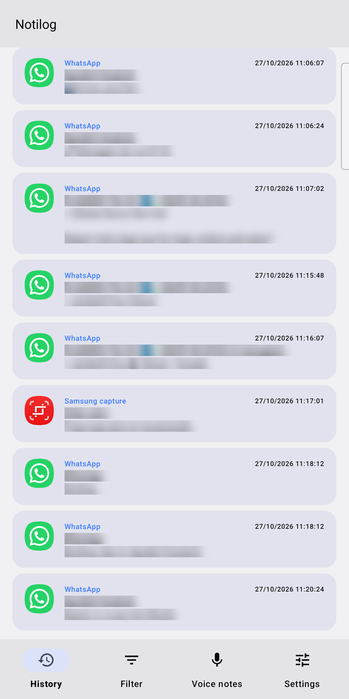
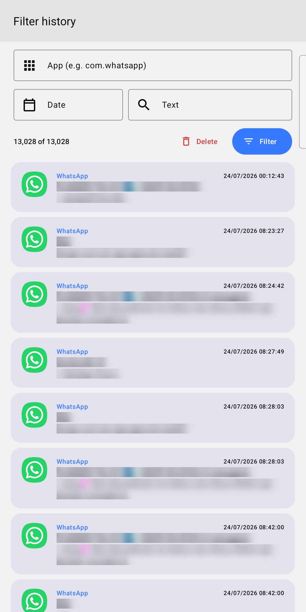
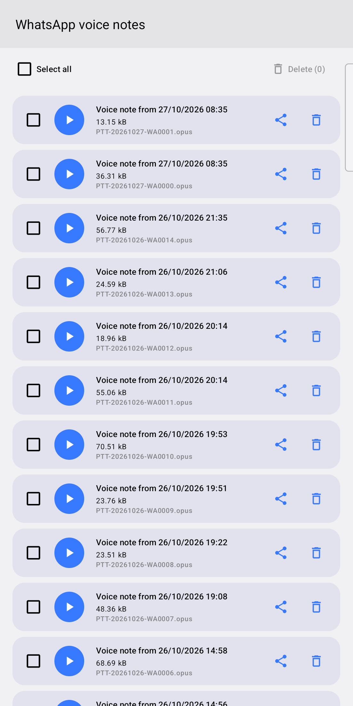
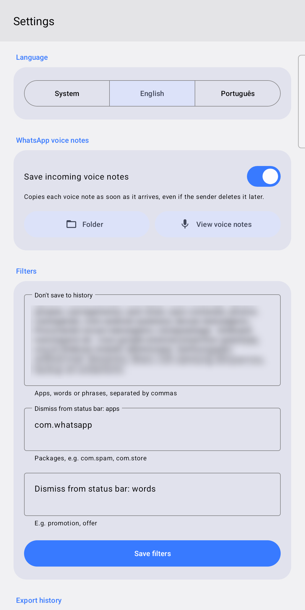

# Notilog

**English** · [Português](README.pt-BR.md)

Android app that keeps a history of every notification you receive, so you can read them later even after they are dismissed or deleted by the sender.

## Features

- **History** – every notification is saved locally (SQLite) with app, title, text and time.
- **Filter** – search the history by app, date or text, and delete the matching items.
- **WhatsApp voice notes** – copies each incoming voice note as soon as it arrives, so it stays available even if the sender deletes it.
- **Filters** – skip apps, words or phrases you don't want in the history, and automatically dismiss notifications from the status bar.
- **Export** – save or share the full history as JSON.
- **Language** – English and Portuguese, following the system or chosen in Settings.

## Screenshots

| History | Filter | Voice notes | Settings |
|:---:|:---:|:---:|:---:|
|  |  |  |  |

Personal data in the screenshots has been blurred.

## Setup

1. Build and install: `./gradlew :NLSExample:installDebug`
2. Open the app and allow **notification access** when asked (Settings › Notifications › Notification access).
3. Optional: in Settings, turn on *Save incoming voice notes* and pick the WhatsApp *Voice Notes* folder.

Requires Android 5.0 (API 21) or newer. All data stays on the device – see the [privacy policy](PRIVACY.md).

## Credits

Started as a fork of [kpbird/NotificationListenerService-Example](https://github.com/kpbird/NotificationListenerService-Example), an example of Android's `NotificationListenerService` API.
