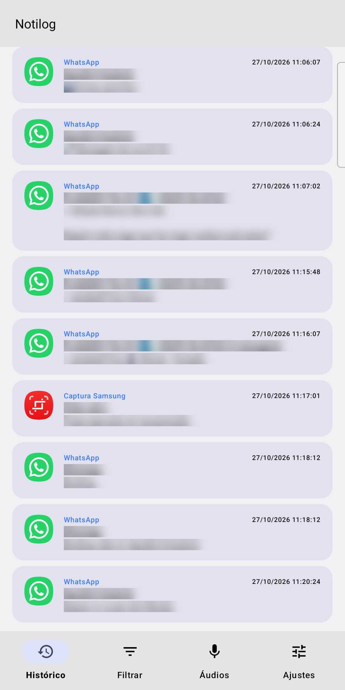
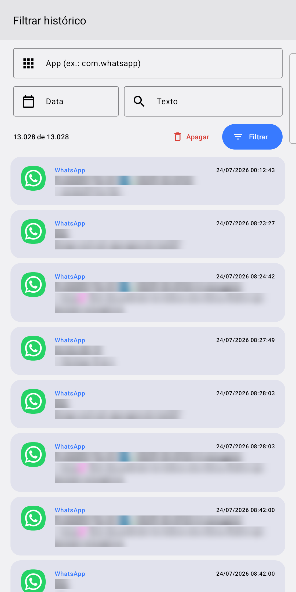
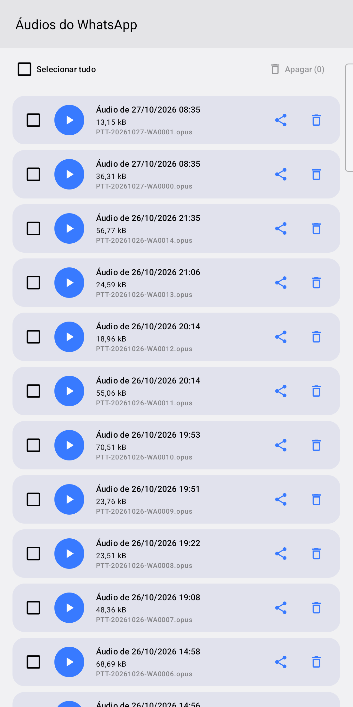
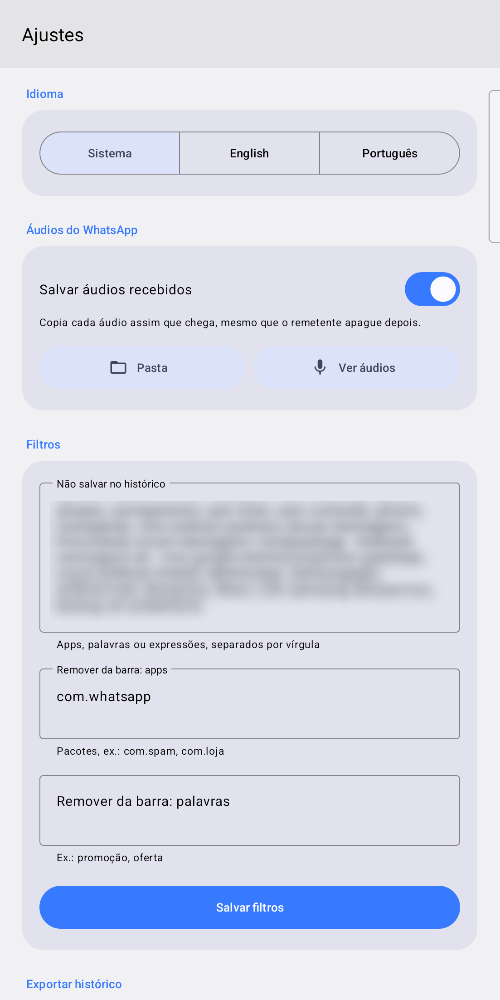

# Notilog

[English](README.md) · **Português**

App Android que guarda o histórico de todas as notificações recebidas, para você ler depois mesmo que tenham sido dispensadas ou apagadas pelo remetente.

## Funcionalidades

- **Histórico**: cada notificação é salva no aparelho (SQLite) com app, título, texto e horário.
- **Filtrar**: busca no histórico por app, data ou texto, e apaga os itens encontrados.
- **Áudios do WhatsApp**: copia cada áudio assim que chega, para ele continuar disponível mesmo que o remetente apague.
- **Filtros**: ignora apps, palavras ou expressões que você não quer no histórico, e remove notificações da barra automaticamente.
- **Exportar**: salva ou compartilha o histórico completo em JSON.
- **Idioma**: português e inglês, seguindo o sistema ou escolhido nos Ajustes.

## Capturas de tela

| Histórico | Filtrar | Áudios | Ajustes |
|:---:|:---:|:---:|:---:|
|  |  |  |  |

Os dados pessoais nas capturas foram desfocados.

## Como usar

1. Compile e instale: `./gradlew :NLSExample:installDebug`
2. Abra o app e permita o **acesso às notificações** quando for pedido (Configurações › Notificações › Acesso às notificações).
3. Opcional: nos Ajustes, ative *Salvar áudios recebidos* e escolha a pasta *Voice Notes* do WhatsApp.

Requer Android 5.0 (API 21) ou mais recente. Todos os dados ficam no aparelho; veja a [política de privacidade](PRIVACY.pt-BR.md).

## Créditos

Começou como um fork de [kpbird/NotificationListenerService-Example](https://github.com/kpbird/NotificationListenerService-Example), um exemplo da API `NotificationListenerService` do Android.
